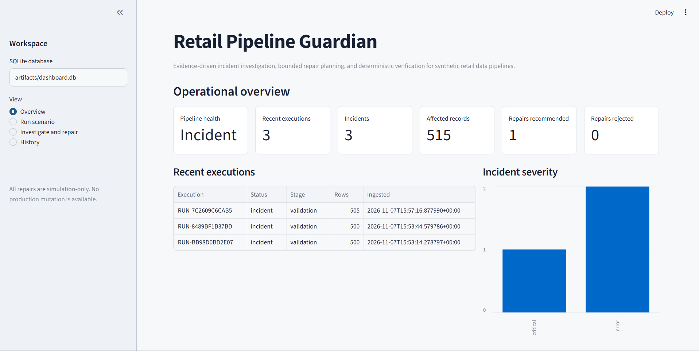
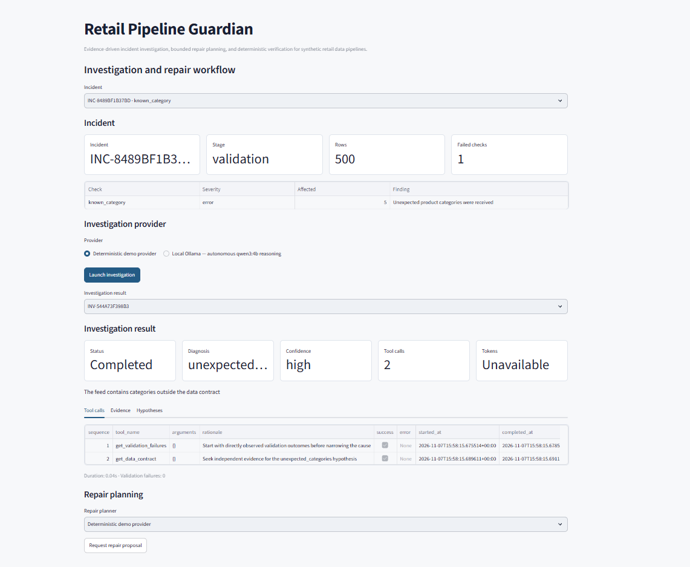
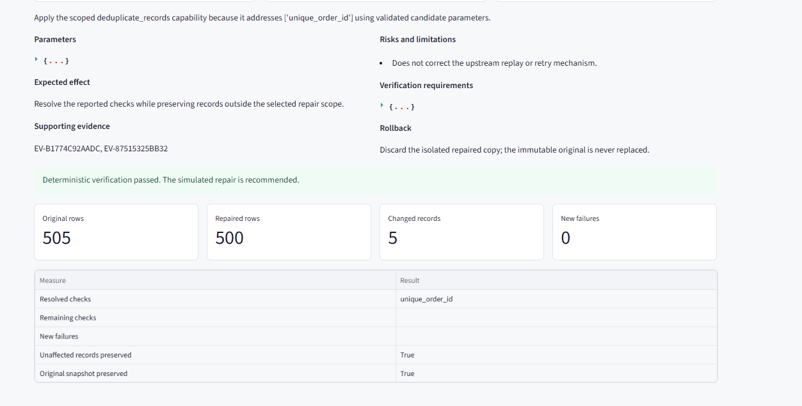
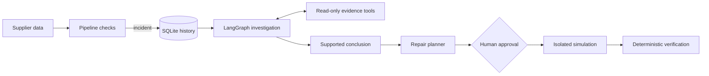

# Retail Pipeline Guardian

Retail Pipeline Guardian investigates failures in a synthetic retail data pipeline. Deterministic
checks detect bad data, then a bounded LangGraph workflow gathers evidence, tracks competing
hypotheses, and either reports a supported cause or stops inconclusively. A separate agent proposes
repairs from a restricted operation catalogue. Repairs require human approval, run against an
isolated dataset copy, and must pass deterministic regression checks before the system recommends
them.



## Demonstration

In a verified deterministic run, the pipeline found 10 affected rows representing five duplicated
order IDs. The investigation collected the validation failure and bounded record samples, then the
repair planner proposed removing only the repeated copies. After approval, the operation ran on an
isolated snapshot. Verification confirmed that `unique_order_id` passed, unaffected records were
preserved, and the repair could be recommended. The original dataset remained unchanged.

The Streamlit dashboard exposes the same workflow: run a scenario, inspect tool calls and evidence,
review a repair proposal, approve its simulation, and examine the verification result. Incidents,
investigations, decisions, evidence, and repair history are persisted in SQLite.

### Investigation trace



### Repair verification



## How it works



Data-quality checks cover schema, uniqueness, nulls, currencies, categories, delivery time, and
statistical price anomalies. The investigation agent can inspect validation results and operational
evidence, while the workflow validates tool arguments, evidence references, hypothesis transitions,
and execution budgets. The repair planner receives only operations valid for the incident and must
produce typed parameters and verification requirements. The model never decides whether a repair
passed.

**Technologies:** Python 3.12, LangGraph, Ollama, Pydantic, SQLite, pandas, Streamlit, and pytest.

## Getting started

From Windows PowerShell:

```powershell
py -3.12 -m venv .venv
.\.venv\Scripts\Activate.ps1
python -m pip install uv
uv sync --extra dev --python 3.12
uv run streamlit run streamlit_app.py
```

Open `http://localhost:8501`. The deterministic provider is sufficient for the complete demo;
Ollama is optional. To use the local model provider, install Ollama and download the configured
model:

```powershell
ollama pull qwen3:4b
```

Run the automated checks with:

```powershell
uv run pytest -q
uv run ruff check .
uv run ruff format --check .
```

## Evaluation

The six-scenario regression benchmark measures classification and workflow behaviour for known
synthetic validation failures; the deterministic baseline resolves all six. It is not a test of
ambiguous upstream reasoning. A separate ten-case causal benchmark gives multiple plausible causes
for the same symptom. The recorded `qwen3:4b` baseline reached 22.2% root-cause accuracy, 0% evidence
support, and 90% workflow completion. The latest isolated live investigation also failed safely
rather than accepting an unsupported conclusion. The current automated suite contains 147 passing
tests.

## Limitations

The datasets and operational evidence are synthetic. Local-model results vary and smaller models
can select weak investigation paths or produce invalid structured decisions. Repairs are limited to
reviewed dataset operations and run only in isolated simulation; the project does not mutate
production data or repair the upstream infrastructure that caused an incident.
